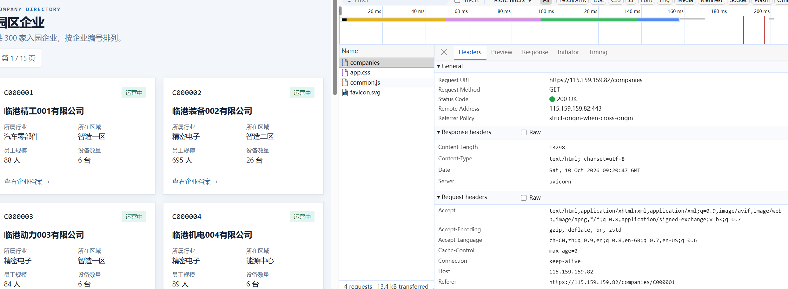
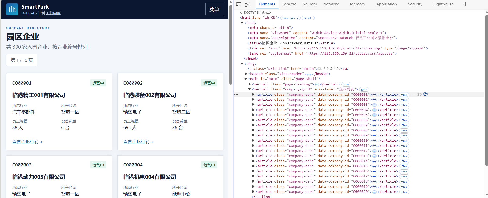
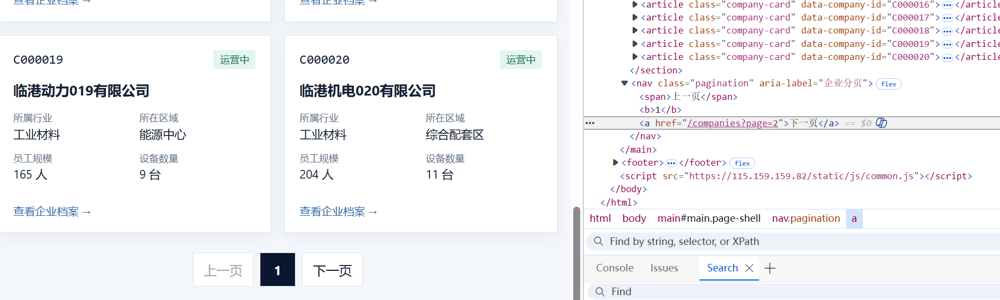
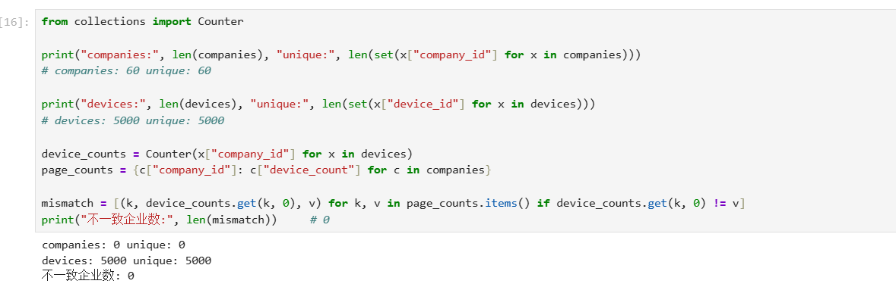

# Lab 1 实验报告

## 学生信息
```text
姓名：蒋和鹏
学号：112404260135
班级：数据1241
GitHub 用户名：u296274
仓库地址:https://github.com/u296274/bigdata-collection-labs-112404260135.git
```
> 文件位置：`lab01/REPORT.md`  
> 完整代码保存在 `lab1_html_api.ipynb`。  
> 本报告只填写关键发现、关键代码、结果和指定截图，**不要把整份 Notebook 复制进来**。

---

# 任务 1：判断数据加载方式

## 1.1 Device：判断动态加载并找到 API

### 判断结果

- 页面：`/devices`
- 数据加载方式：**动态加载**
- 判断依据：

1. 在“查看网页源代码”中搜索页面上已有的设备编号 `D00000001`，**搜不到**；源代码里表格主体只有一个占位行：
   `<tbody id="device-rows"><tr><td colspan="8" class="loading-cell">正在加载…</td></tr></tbody>`，
   并且页面底部引入了 `static/js/devices.js`，说明设备数据不是随初始 HTML 返回，而是由脚本执行后再填充。
2. 打开 `F12 → Network → Fetch/XHR` 并刷新页面，能看到请求 `/api/devices?page=1&page_size=50`，其 Response 为 JSON，`total = 5000`、`items` 为设备数组，即真正返回设备列表的接口。

### API 信息

- Request URL：`https://115.159.159.82/api/devices`
- Request Method：`GET`
- Query 参数：
  - `page`：页码，从 1 开始，默认 1
  - `page_size`：每页条数，取值 1～100，默认 50
  - （可选筛选参数）`company_id`、`device_type`、`status`、`zone`

### 【截图 1】Device API 发现证据

文件名：

```text
images/01_device_api.png
```

> 待补图：浏览器 DevTools 的 Network 面板，选中返回设备列表的 Fetch/XHR 请求，右侧 Headers 中可见 Request URL 与 Query String Parameters。



---

## 1.2 Company：判断静态加载

- 页面：`/companies`
- 数据加载方式：**静态加载**
- 判断依据：

使用“右键 → 查看网页源代码”后，按 `Ctrl + F` 搜索页面中真实显示的企业名称（如 `临港精工001有限公司`），在源代码中**能够直接命中**：该企业所在的完整卡片 `<article class="company-card" data-company-id="C000001">` 连同行业、区域、设备数量等字段都随 HTML 一起返回。说明本页由服务端渲染，不需要再去找 API。

### 【截图 2】Company 静态加载证据

文件名：

```text
images/2_company_source.png
```

> 待补图：`/companies` 的“查看网页源代码”页面，`Ctrl + F` 搜索企业名称并高亮命中位置。



---

# 任务 2：Device API 分页采集

## 2.1 API 分页结构

| 含义 | JSON 字段 |
|---|---|
| 当前页 | `page` |
| 每页条数 | `page_size` |
| 设备总数 | `total` |
| 设备列表 | `items` |

---

## 2.2 关键代码

```python
# 从第一页响应中读取分页信息
total = data["total"]
page_size = data["page_size"]

total_pages = (total + page_size - 1) // page_size

devices = []

for page in range(1, total_pages + 1):
    r = requests.get(
        api_url,
        params={
            "page": page,
            "page_size": page_size
        },
        timeout=10
    )

    page_data = r.json()
    page_items = page_data["items"]
    devices.extend(page_items)
```

---

## 2.3 采集结果

- 每页条数：`50`（接口默认值）
- 设备总数：`5000`
- 程序计算得到的总页数：`100`
- 最终采集设备数：`5000`
- 唯一 `device_id` 数：`5000`

回答：

> 为什么总页数应由 API 返回的 `total` 和 `page_size` 计算，而不是直接在代码里写死？

答：`total` 和 `page_size` 都是服务端在运行时返回的真实数据，只有用 `(total + page_size - 1) // page_size` 现算，代码才能同时适应两种情况的变化：一是数据量变化（设备增加到 6000 台时，写死的 100 页会漏采后 1000 台）；二是自己调整 `page_size`（改成 100 时实际只需 50 页，写死 100 页会白跑 50 次空请求）。写死页数等于把“数据有多少”“每页取多少”这两个运行期变量硬编码进了代码，参数一变就失效。

---

# 任务 3：Company HTML 解析

## 3.1 企业记录 Selector

- 企业记录 selector：`article.company-card`
- 第 1 页企业记录数：`20`

说明为什么选择这个 selector：

- 主要使用了 `id / class / data-* / 父子层级` 中的哪一种？
  **class**（辅以 `data-*` 属性取字段）。
- 是否参考过浏览器 Copy selector 或 AI？
  参考过浏览器 Copy selector，但得到的是 `html body main section.company-grid article:nth-child(1)` 这类带 `nth-child` 的长路径，它只能锁定第 1 条记录，换页就失效，因此没有采用。
- 最终为什么采用现在这个写法？
  `company-card` 是每条企业记录最外层节点上语义明确且唯一的 class，一条记录对应一个 `<article>`，写出来短、稳定，对页面层级调整不敏感；记录内部的 `company_id` 直接读 `data-company-id` 属性，不必解析文本。

答：见上。

---

## 3.2 关键代码

```python
cards = soup.select("article.company-card")

card = cards[0]

company_id = card.get("data-company-id")
name = card.select_one("h2 a").get_text(strip=True)
status = card.select_one("span.badge").get_text(strip=True)
```

行业、区域、设备数量使用 `dt/dd` 结构后，请写出你最终如何得到：

```python
details = {}
for item in card.select("dl > div"):
    details[item.select_one("dt").get_text(strip=True)] = item.select_one("dd").get_text(strip=True)

industry = details["所属行业"]
zone = details["所在区域"]
device_count = int(details["设备数量"].replace("台", "").strip())
```

提取结果示例（第一条记录）：

```python
{'company_id': 'C000001', 'name': '临港精工001有限公司', 'industry': '汽车零部件',
 'zone': '智造一区', 'device_count': 6, 'status': '运营中'}
```

---

## 3.3 字段来源说明

1. 字段：`company_id`
   - 来自：**HTML 属性**
   - 使用的方法：卡片最外层 `article` 带 `data-company-id="C000001"`，直接用 `card.get("data-company-id")` 读取属性值。取属性比解析 `<span class="mono">` 的文本更稳，因为属性不会受排版或文本改写影响。

2. 字段：`device_count`
   - 来自：**文本**
   - 使用的方法：先遍历 `card.select("dl > div")`，把每个 `dt` 文本作为键、`dd` 文本作为值组装成 `details` 字典，再取 `details["设备数量"]`，其原始值为 `"6 台"`，用 `.replace("台", "").strip()` 去掉单位与空格后 `int()` 转成整数 `6`（后续要与 Device 统计结果做数值比较，必须是 int）。

---

# 任务 4：Company “下一页”分页

## 4.1 下一页元素

- “下一页” selector：`nav.pagination a:-soup-contains("下一页")`
- 第 1 页 `href` 示例：`/companies?page=2`

> 说明：页脚分页导航的结构在每页并不相同。第 1 页是
> `<span>上一页</span><b>1</b><a href="/companies?page=2">下一页</a>`，
> 而从第 2 页起“上一页”也是 `<a>`：`<a href="/companies?page=1">上一页</a><b>2</b><a href="/companies?page=3">下一页</a>`。
> 因此不能简单取 `nav.pagination` 下的第一个 `<a>`（那样第 2 页会取到“上一页”，导致翻页倒退），必须按文本“下一页”匹配。

### 【截图 3】Company “下一页”元素

文件名：

```text
images/03_company_next.png
```

> 待补图：DevTools 的 Elements 面板，页脚“下一页”对应的 `<a>` 元素被选中，能看清其 `class` 与 `href` 属性。



---

## 4.2 关键代码

```python
next_link = soup.select_one('nav.pagination a:-soup-contains("下一页")')

next_href = next_link.get("href")

next_url = urljoin(
    current_url,
    next_link.get("href")
)
```

再用 2～3 句话说明：

> 你的程序如何完成“当前页 → 找下一页 href → 请求下一页 → 再解析”的循环？

答：程序先以 `current_url` 请求当前页，用同一份 `soup` 解析出本页 20 条企业记录；然后在页脚 `nav.pagination` 中按文本“下一页”取出 `<a>` 元素（末页该元素不存在，`select_one` 返回 `None`，循环随即终止）。取到的 `href` 是相对路径（`/companies?page=2`），用 `urljoin(current_url, href)` 拼成绝对地址后赋给 `current_url`，进入下一轮请求与解析，共循环 3 轮。

---

## 4.3 三页采集结果

| 页码 | 企业数 |
|---|---:|
| 1 | 20 |
| 2 | 20 |
| 3 | 20 |
| **合计** | **60** |

- 唯一 `company_id` 数：`60`

采集到的编号区间：第 1 页 `C000001~C000020`，第 2 页 `C000021~C000040`，第 3 页 `C000041~C000060`，三页之间没有重复。

---

# 任务 5：结果验证

## 5.1 最终结果

| 检查项 | 结果 |
|---|---:|
| Company 总数 | 60 |
| 唯一 `company_id` | 60 |
| Device 总数 | 5000 |
| 唯一 `device_id` | 5000 |
| Company–Device 不一致企业数 | 0 |

### 【截图 4】最终验证结果

文件名：

```text
images/04_validation.png
```

> 待补图：JupyterLab 中同一个单元格的运行输出，需同时显示 Company 总数、唯一 company_id 数、Device 总数、唯一 device_id 数、Company–Device 不一致企业数。

可参考的输出内容：

```text
companies: 60
unique company_id: 60
devices: 5000
unique device_id: 5000
mismatch_count: 0
```



---

## 5.2 一致性检查关键代码

```python
from collections import Counter

device_counts = Counter(
    x["company_id"] for x in devices
)

mismatch_count = 0

for company in companies:
    cid = company["company_id"]
    expected = company["device_count"]
    actual = device_counts.get(cid, 0)

    if expected != actual:
        mismatch_count += 1
```

回答：

> 为什么 `status_code == 200` 仍然不能说明“数据已经采集正确”？

答：状态码 200 只表示这一次 HTTP 请求被服务端正常处理并返回了响应，它不携带任何关于“数据是否完整、是否正确落进结果集”的信息。分页参数写错只采到第一页、CSS selector 写偏导致漏采或错位、翻页逻辑取到“上一页”造成重复或死循环、字段解析错位——这些错误发生时每一次请求依然都是 200。所以必须在采集完成后用总量核对、`id` 唯一性检查和跨数据源一致性（把 Company 页面的 `device_count` 与 Device API 统计出的数量逐家比对）来验证数据本身。

---

# 任务 6：保存采集结果

确认已经生成：

```text
data/companies.json
data/devices.json
```

填写：

- `companies.json`：**已生成**
- `devices.json`：**已生成**

两个文件均为 UTF-8 编码，使用 `json.dump(..., ensure_ascii=False, indent=2)` 保存，公司 `device_count`、设备 `rated_power_kw` 等数值字段保持原始类型。

---

# 实验结论

用 **80～150 字**总结：

1. 静态加载与动态加载页面的处理方式有什么不同；
2. HTML “下一页”分页和 API `page` 分页有什么不同；
3. 你使用了哪些方法验证采集结果。

答：静态页面的数据随 HTML 一次返回，用 `requests` 取到文本后交给 BeautifulSoup + CSS Selector 解析即可；动态页面的数据由 JS 异步加载，必须先在 Network 中找到返回 JSON 的 API，再按接口分页参数请求。HTML 分页要跟着页面提供的“下一页”链接走，并处理相对地址与末页无链接的情况；API 分页则由 `total` 与 `page_size` 计算页数，与页面结构无关。验证上我核对了总量与 `id` 唯一性，并把 Company 的 `device_count` 与 Device API 的实际统计结果逐家比对，不一致企业数为 0。
