# 实验二报告：房源采集与 MySQL 存储

- 班级：数据1241
- 姓名：蒋和鹏
- 学号：112404260135
- 实验日期：2026-10-27
- GitHub 仓库链接：https://github.com/u296274/bigdata-collection-labs-112404260135
- 源码文件名：`anjuke.ipynb`（同目录附可独立运行的 `anjuke.py`、`load_mysql.py`、`check_samples.py`）
- 数据库与表：`smartpark_lab.houseinfo`
- 数据来源：在线教学站（http://www.bspider.top/anjuke/）
- 访问时间及结果：2026-10-27 17:00 前后。首次仅带 `User-Agent: Mozilla/5.0` 请求返回状态码 200、标题「访问验证-安居客」（验证页）；补全浏览器 UA 并加 `Accept-Language: zh-CN` 后返回正常房源列表页（标题「重庆二手房房产网…- 58安居客」，约 280KB），共采集 10 页。
- 快照文件来源与文件名：不适用（在线采集成功）

> 填写要求：截图放在 `images/` 中，在对应位置插入图片。代码截图要显示文件名、行号或单元位置，用红框标出关键代码，每项写2—3句话解释。只截最终结果或只贴 AI 生成的文字，不能代替实验过程。未完成的项目写明原因，不填写预期结果，不展示个人账号密码。

## 第一阶段：MySQL Docker 更新与启动

- 本次是否需要更新：已完成更新（课程目录中已有 L05 配套文件，与教师增量更新包逐文件 SHA256 比对：`start-mysql.bat`、`stop-mysql.bat`、`mysql-console.bat`、`l05-mysql-fresh-volume.yaml` 一致；`l05-mysql.ps1` 课程目录中为更新版本，按 README「已有同名文件不覆盖」保留，未覆盖 `.env`、`workspace` 和原 `docker-compose.yml`，保留原数据卷）
- 更新或启动遇到的问题：`start-mysql.bat` 首次运行报 `[FAIL] 未找到MySQL镜像`。排查发现 Docker Desktop 安装在 `D:\Docker`，脚本用 `Get-Command docker.exe` 找不到命令。把 `D:\Docker\resources\bin` 加入 PATH 后重新运行即通过；镜像本身一直存在，`docker image inspect mysql:8.4.11` 返回 `sha256:85b9bf2e29cf…f2a`，与 README 预期一致。

### 启动环境与建表

依次使用 `start-course.bat`、`start-mysql.bat`、`mysql-console.bat` 启动课程环境、数据库和 MySQL 终端。

`start-mysql.bat` 输出：

```text
[PASS] Docker课程MySQL保护检查通过；Windows本机MySQL不会被操作。
[PASS] L05 MySQL healthy，账号连接检查通过。
```

MySQL 终端中执行：

```sql
SHOW DATABASES;
USE smartpark_lab;
SHOW TABLES;
CREATE TABLE IF NOT EXISTS houseinfo ( ... ) CHARACTER SET utf8mb4;  -- 9列完整SQL见 anjuke.ipynb
DESCRIBE houseinfo;
SELECT COUNT(*) AS before_count FROM houseinfo;
```

**截图：** MySQL 启动成功提示，以及终端中 `USE smartpark_lab`、`SHOW TABLES`、`DESCRIBE houseinfo` 的执行结果。可分图。

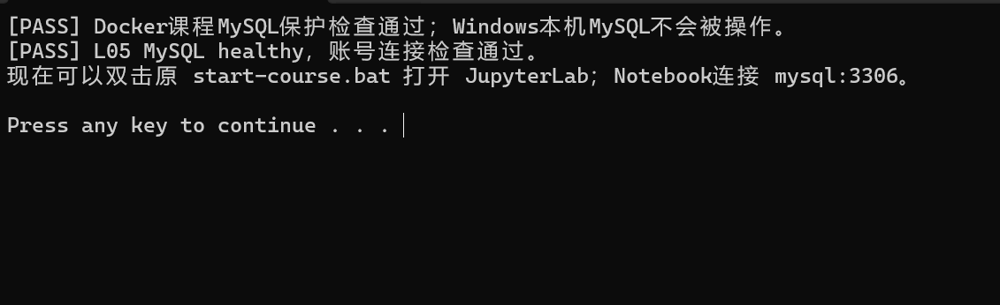

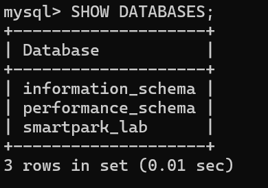

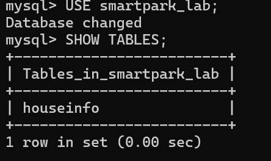

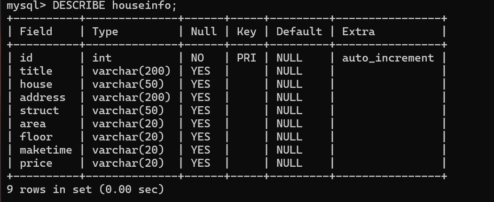

【待补截图：images/before-count.png —— MySQL 终端中 `SELECT COUNT(*) AS before_count FROM houseinfo;`（结果 0）的执行画面】

说明：当前使用哪个数据库？`id` 和8个房源字段分别保存什么？

答：当前使用 `smartpark_lab` 数据库。`id` 是 INT 自增长主键，由数据库自动生成，用于唯一标识每条记录；其余 8 列保存采集结果：`title` 卖点标题、`house` 楼盘名称、`address` 地址、`struct` 户型、`area` 建筑面积（保留单位）、`floor` 楼层、`maketime` 建造年代、`price` 每平方米单价（保留单位）。

## 第二阶段：房源采集与 CSV 数据存储

### 1. 网页分析与房源解析

#### 选择器是怎样得到的

在 Chrome 中按 F12，使用 **Elements → Copy → Copy selector**。选一个字段，记录从完整路径到相对选择器的过程。

- 选择的字段：标题（h3）
- 复制的原始选择器：（在 F12 中对第一条房源标题执行 Copy selector，得到从页面根节点出发、含多层 `>` 和 `nth-child()` 的长路径，形如 `#app > div:nth-child(3) > … > h3`，本页面为动态渲染组件，路径长且不稳定）
- 一条房源的父容器选择器：`div.property`（每个房源一个，同时包含标题、楼盘、地址、属性组和价格；逐条核对第 1、2 条 class 相同）
- 最终使用的相对选择器：先 `soup.select("div.property")` 取全部房源，再在每条内用 `row.select_one("h3")` 取标题

**截图：** 框出该字段的 HTML 节点和房源父容器，展示选择器的匹配结果。

【待补截图：images/selector.png —— F12 中框出标题节点与 div.property 父容器，及 Copy selector 结果】

请求第一页并检查的代码（含验证页检测）：

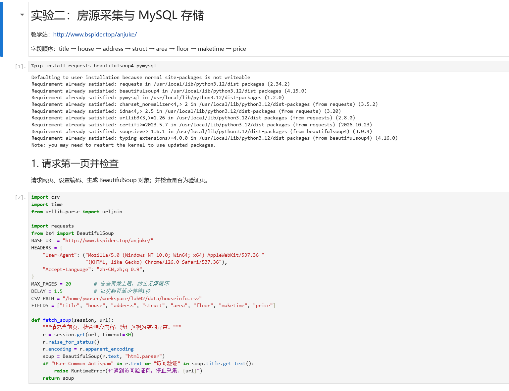

说明：删掉了哪些层级？怎样确认父容器刚好包含一条房源？

答：删掉了从页面根节点到房源节点之间的所有中间层级（整条长路径），改用「先选容器、再容器内相对查找」的两步法。确认方法：在 Elements 面板把鼠标悬停在 `div.property` 上，网页高亮区域刚好框住一条房源的全部内容（标题、楼盘、地址、属性、价格），不多不少；再检查第二条房源使用相同 class，且 `len(soup.select("div.property"))` 等于页面可见房源数（60）。

#### 解析8个字段

解析代码见 `anjuke.ipynb`「解析一条房源」单元（对应 `anjuke.py` 的 `parse_row()`）：

- 标题：`row.select_one("h3")`
- 楼盘：`row.select_one("p.property-content-info-comm-name")`
- 地址：`row.select_one("p.property-content-info-comm-address")` 内多个 `span` 直接拼接，不插入空格，如「南岸学府大道二塘路59号」
- 户型/面积/朝向/楼层/建造年代：同在 `div.property-content-info`（非 comm 版本）的 `p.property-content-info-text` 列表，顺序为户型、面积、朝向、楼层、年代；按下标取前两项前检查 `len(ps)`，楼层与年代按文字特征分类（含「层」为楼层、以「建造」结尾为年代），防止把朝向当楼层；年代缺失时填空字符串
- 单价：`row.select_one("p.property-price-average")`，如「16465元/㎡」，不是 `property-price-total` 的总价「148万」

首条解析输出：`['万科物业自营 南坪六公里金域翰林 三号线精装正三房带家具电器', '万科金域学府翰林菁华里', '南岸学府大道二塘路59号', '3室2厅1卫', '89.9㎡', '低层(共27层)', '2019年建造', '16465元/㎡']`

**截图：** 自己编写的解析代码和首条房源的8个字段输出。代码中必须框出：

- `select()` 和 `select_one()`。
- 面积、单价的定位与取值。
- 建造年代的提取和缺失处理。

可分成几张局部截图。另附面积、单价对应的 HTML 节点或网页原文。

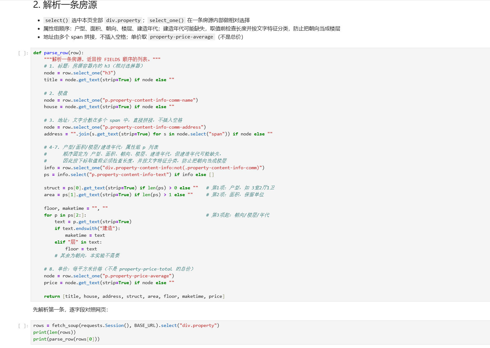

首条房源 8 个字段的输出见上方 `pagination-log.png` 底部「样本第1条」（与 `csv-reread-output.png` 中的样本一致）。

说明：两个选择方法各用在哪里？怎样确认面积和单价没有取错？

答：`select("div.property")` 用在整页范围，返回所有房源节点列表；`select_one()` 用在单条房源内部做相对选择（标题、楼盘、地址、属性组、单价），范围只限于这一条。确认方法：面积取属性组第 2 项（第 1 项是户型），对照网页原文「89.9㎡」带面积单位；单价取 `property-price-average` 的「16465元/㎡」并对照网页每平方米价格，与 `property-price-total` 的「148万」总价明显不同；面积、单价均保留了原单位，与网页一致。

### 2. 下一页采集

- 下一页 `href` 原值：`?page=2`（`a.next.next-active`，即活动的下一页按钮；`get_text()` 是「下一页」文字，地址要用 `get("href")` 取）
- 用 `urljoin()` 补全后的地址：`http://www.bspider.top/anjuke/?page=2`
- 实际停止原因：第 10 页为末页——分页区域仍存在，但「下一页」按钮不再带 `next-active`（已禁用），按教程判定为正常采集完成；未触发安全页数上限（20 页）、地址越界或重复等中止条件

分页日志（每页输出页码、URL、本页条数、累计条数）：

```text
第1页 | http://www.bspider.top/anjuke/           | 本页60条 | 累计60条
第2页 | http://www.bspider.top/anjuke/?page=2    | 本页60条 | 累计120条
…
第10页 | http://www.bspider.top/anjuke/?page=10  | 本页60条 | 累计600条
停止原因：第10页为末页：下一页按钮已禁用，采集完成
```

**截图：** 框出提取 `href`、补全地址、循环更新地址和停止条件的代码。附前两页的运行日志，以及最终停止提示。离线实验展示快照中的href、补全结果和文件读取记录，注明"离线回放"，不算在线翻页成功。

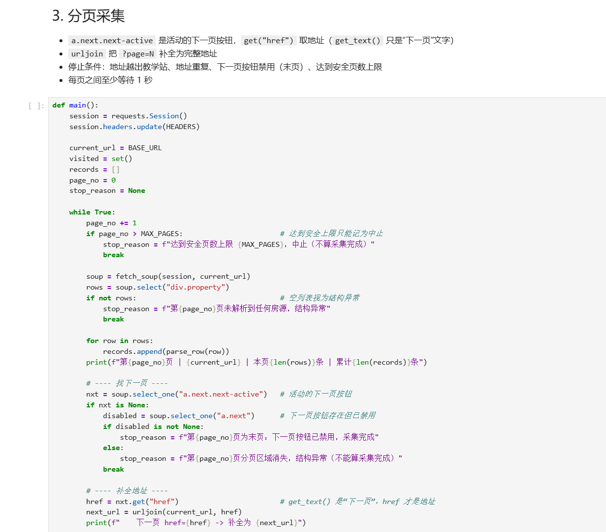

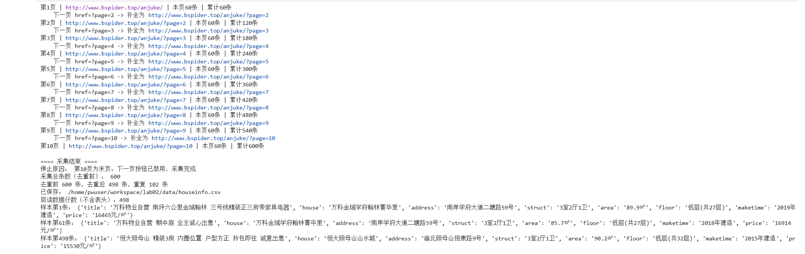

说明：怎样进入下一页？怎样防止重复采集或无限循环？

答：每页解析完后用 `select_one("a.next.next-active")` 找活动的下一页按钮，`get("href")` 取相对地址，`urljoin(current_url, href)` 补全成完整地址后更新 `current_url`。防重复/防死循环：用 `visited` 集合记录访问过的地址，下一页地址越出教学站前缀或已在集合中就停止并报错；另有 20 页安全上限，达到只能记为中止；每页之间 `time.sleep(1.5)` 秒。采前 2 页时确认第 2 页与第 1 页无重复内容后再继续。

### 3. 保存 CSV

保存代码：`csv.writer`，编码 `utf-8-sig`，`newline=""`，表头为 8 个字段名，文件 `data/houseinfo.csv`。

去重结果：去重前 600 条，按 8 个字段完全相同去重后 **498 条**（重复 102 条）。

回读核对：`csv.DictReader` 重新读取，表头与字段顺序一致，数据行数 **498**（不含表头）；抽查第 1 条、第 61 条（跨页）和最后 1 条，地址完整、面积和单价单位正确。

**截图：** CSV保存与回读代码、回读条数。框出编码、表头和数据写入部分。

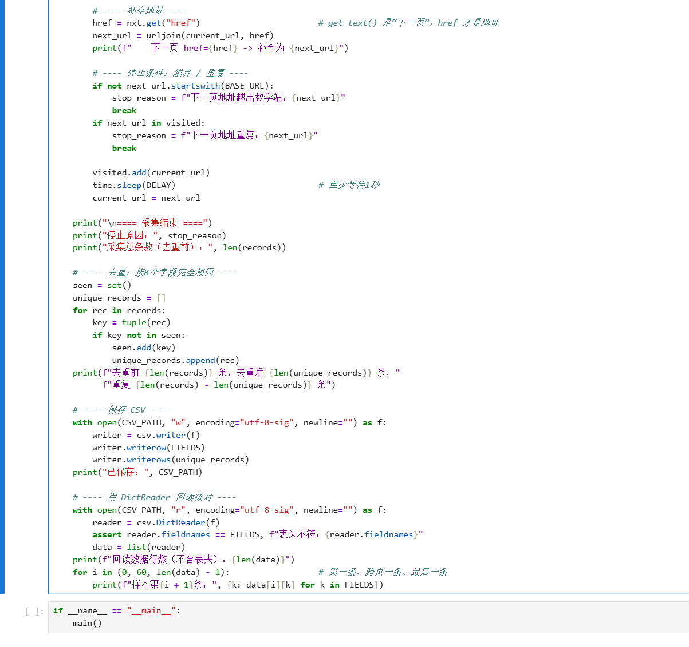

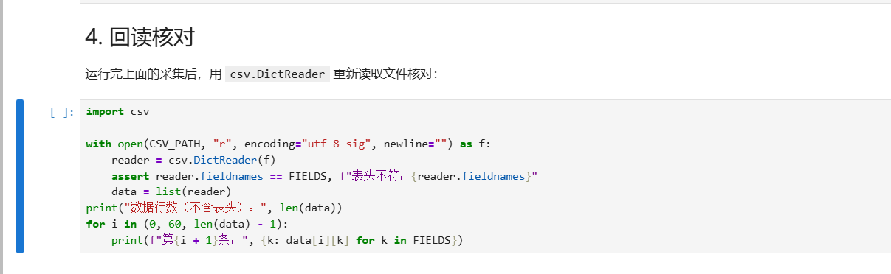

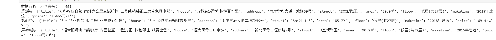

CSV 开头（表头和数据）：

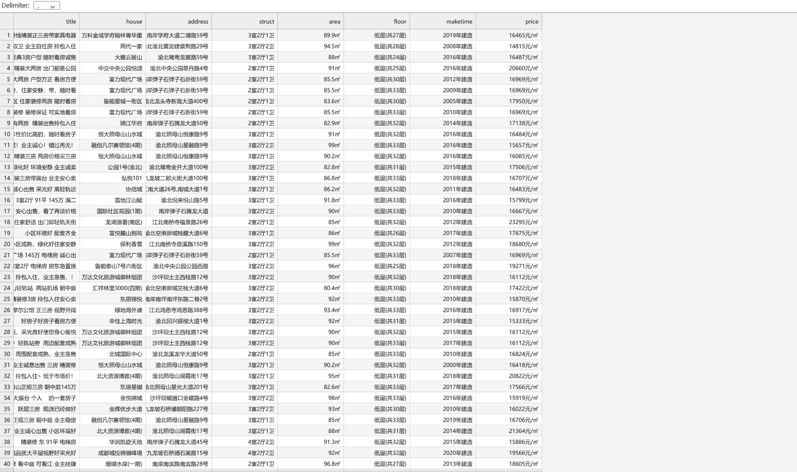

CSV 行数（数据行 498 行 + 表头 1 行 = 499 行；去重前共采集 600 条）：

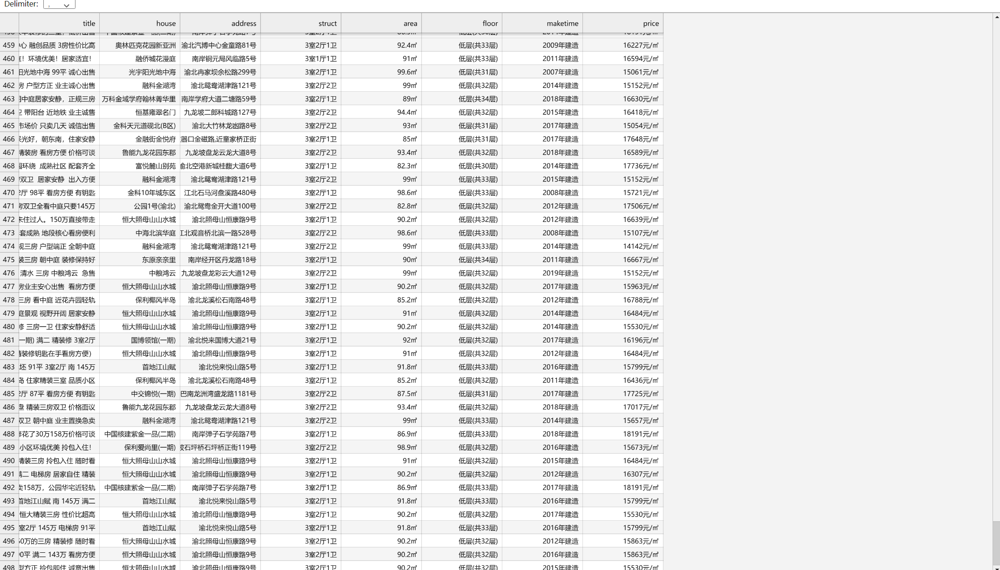

说明：8个字段的顺序是什么？按8个字段完全相同去重后，保存了多少条记录？

答：顺序为 `title → house → address → struct → area → floor → maketime → price`，与建表字段一致。按 8 个字段完全相同去重后保存了 498 条记录（去重前 600 条，完全相同的重复记录 102 条）。教学站同一房源以不同卖点标题多次出现导致重复，去重是教程明确要求；去重前条数已在日志中记录。

## 第三阶段：MySQL 数据存储

### 1. 读取 CSV 并入库

本阶段读取第二阶段的 `data/houseinfo.csv`，不重新采集。

入库代码见 `load_mysql.py`（与 `anjuke.ipynb` 第三阶段单元相同）：`csv.DictReader` 读取并检查表头，按 8 字段固定顺序整理 `records = [tuple(row[k] for k in FIELDS) for row in reader]`；`pymysql.connect(host="mysql", port=3306, user="student", …, database="smartpark_lab", charset="utf8mb4", autocommit=False)`；先 `SELECT COUNT(*)` 确认连接并记录入库前条数。

**截图：** 框出读取CSV、按8个字段整理入库参数的代码。

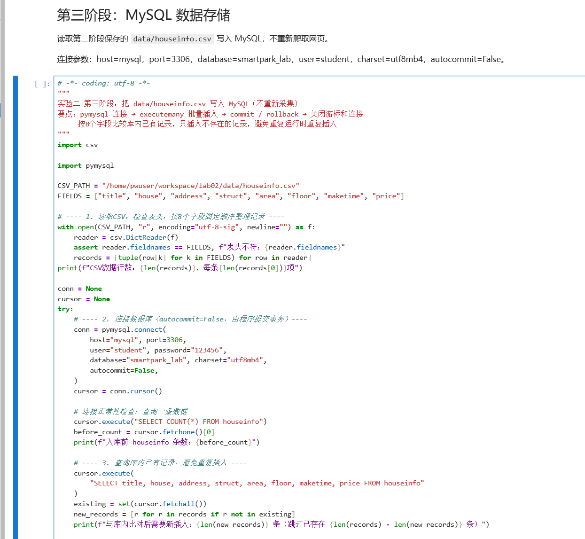

**截图：** 自己编写的入库代码。框出 `executemany()`、`commit()`、`rollback()`，以及关闭游标和连接的操作。另框出避免重复插入的代码。

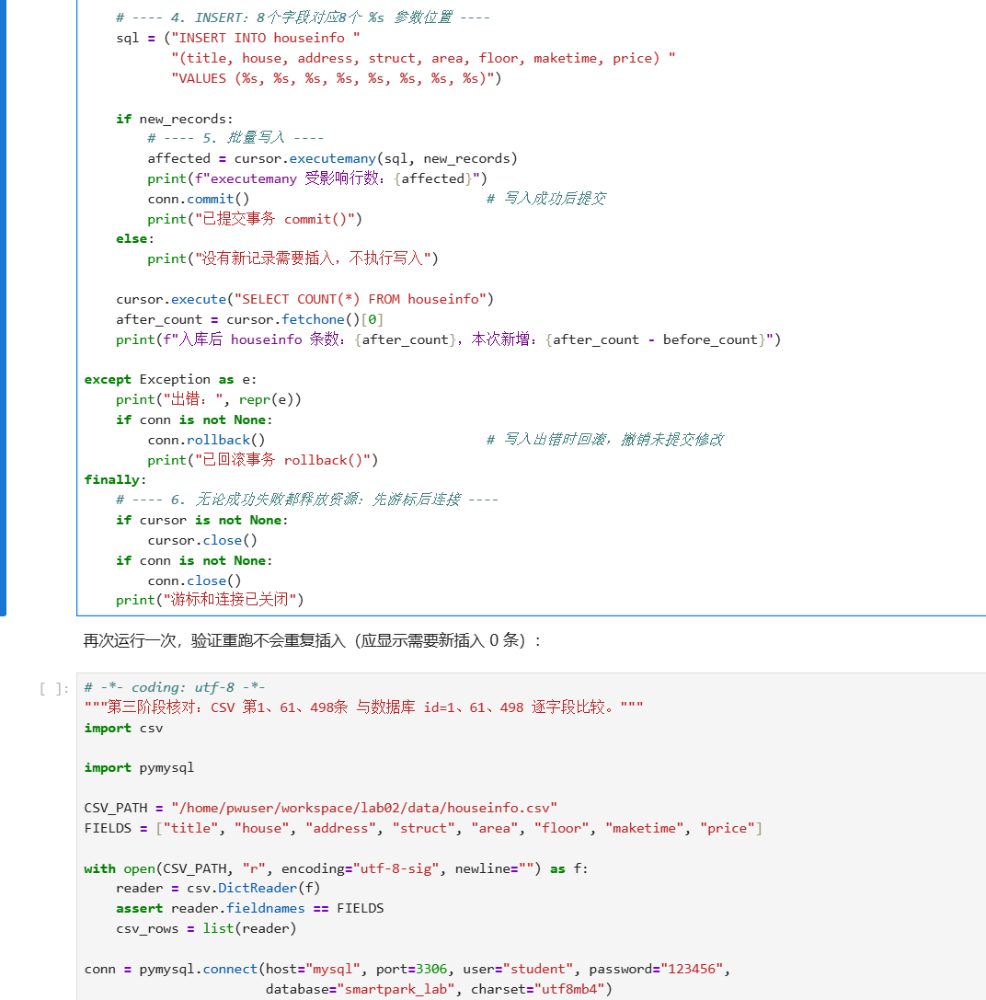

说明：每条记录怎样对应8个参数？成功、失败时分别做什么？再次运行时怎样避免重复插入？

答：INSERT 语句写明 8 个字段和 8 个 `%s` 参数位置，顺序与 FIELDS 一致，`executemany(sql, records)` 中每条记录是按 FIELDS 顺序取值组成的 8 元组，参数化传入，不用字符串拼接。成功后调用 `conn.commit()` 提交事务；出错进入 except 调 `conn.rollback()` 撤销未提交的修改；finally 中先 `cursor.close()` 再 `conn.close()` 释放资源，连接未创建成功时先判断非 None 再关闭。重跑防重：入库前先 `SELECT title,house,…,price FROM houseinfo` 把已有 8 字段记录读入集合，只插入集合中不存在的记录，不清空表。

运行结果（第一次）：

```text
CSV数据行数：498，每条8项
入库前 houseinfo 条数：0
与库内比对后需要新插入：498 条（跳过已存在 0 条）
executemany 受影响行数：498
已提交事务 commit()
入库后 houseinfo 条数：498，本次新增：498
游标和连接已关闭
```

重跑（关闭程序后再次独立运行）：

```text
入库前 houseinfo 条数：498
与库内比对后需要新插入：0 条（跳过已存在 498 条）
没有新记录需要插入，不执行写入
入库后 houseinfo 条数：498，本次新增：0
```


### 2. 核对结果

#### 查询条数和样本

MySQL 终端执行：

```sql
USE smartpark_lab;
DESCRIBE houseinfo;
SELECT COUNT(*) AS after_count FROM houseinfo;   -- 498
SELECT title, house, address, struct, area, floor, maketime, price
FROM houseinfo ORDER BY id LIMIT 5;
```

**截图：** MySQL 终端中的入库前后 `SELECT COUNT(*)`、重跑后的条数，以及 `SELECT ... LIMIT 5` 的结果。

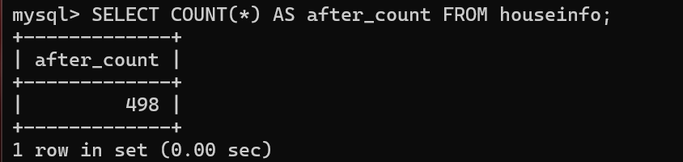

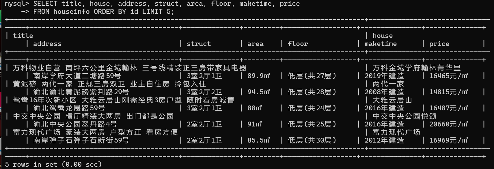

| 项目 | 实际结果 |
|---|---|
| 成功采集页数 | 10 页 |
| 采集记录数（去重前） | 600 |
| 完全相同的重复记录数 | 102 |
| CSV数据行数（不含表头） | 498 |
| 入库前条数 | 0 |
| 入库后条数 / 本次新增条数 | 498 / 498 |
| 关闭上次程序后，同批数据独立重跑的条数 / 新增条数 | 0 / 0（跳过 498 条已存在，无重复增加） |
| 是否采集完整；未完成的原因 | 完整。第 10 页分页区域存在且「下一页」按钮已禁用，判定末页 |

说明：首次入库后的条数应等于去重后的CSV数据行数，8个字段的内容也应一致。若不一致，说明原因。总条数以实际结果为准。

答：一致。首次入库后 498 条，等于去重后的 CSV 数据行数 498；总条数以实际采集为准（教学站当前共 10 页 600 条，去重后 498 条，与旧报告的 601 条不同属正常）。

#### 逐条核对

选取第一条、跨页一条和最后一条，比较网页、CSV与数据库中的8个字段。快照实验对照教师提供的网页文件。

核对方法：`check_samples.py` 读取 CSV 第 1、61、498 条，与数据库 `WHERE id IN (1,61,498)` 的记录逐字段比较，三条均输出「逐字段一致: True」。

- 样本1（页码或URL、记录位置）：第1页（http://www.bspider.top/anjuke/）第1条 → CSV第1行 → 数据库 id=1；万科物业自营 南坪六公里金域翰林…｜万科金域学府翰林菁华里｜南岸学府大道二塘路59号｜3室2厅1卫｜**89.9㎡**｜低层(共27层)｜**2019年建造**｜**16465元/㎡**
- 样本2（页码或URL、记录位置）：第2页（?page=2）第1条 → CSV第61条 → 数据库 id=61；万科物业自营 朝中库 业主诚心出售…｜万科金域学府翰林菁华里｜南岸学府大道二塘路59号｜3室2厅1卫｜**85.7㎡**｜低层(共27层)｜**2018年建造**｜**16914元/㎡**
- 样本3（页码或URL、记录位置）：第10页（?page=10）最后1条 → CSV第498条 → 数据库 id=498；恒大照母山 精装3房 内环位置 户型方正 拎包即住…｜恒大照母山山水城｜渝北照母山恒康路9号｜3室2厅1卫｜**90.2㎡**｜低层(共32层)｜**2015年建造**｜**15530元/㎡**

**截图：** 三条样本的对照结果，框出面积、单价和年代。可分图。

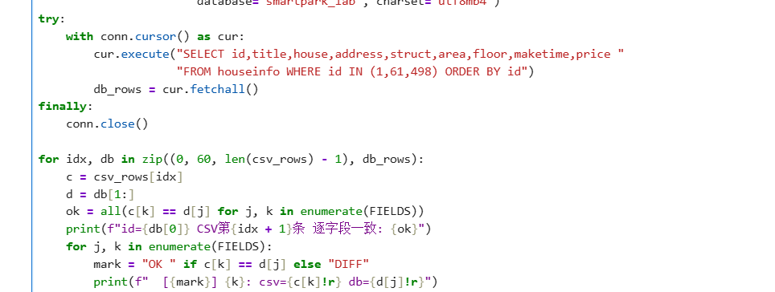

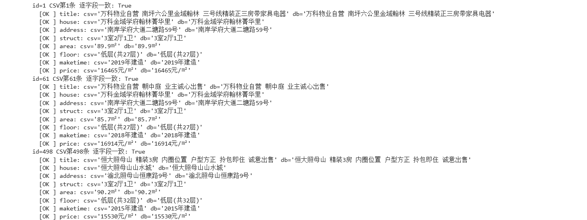

核对结论及差异：三条样本 8 个字段在网页、CSV、数据库三处完全一致，无差异。

## 问题与解决

- 遇到的问题、处理方法及结果：
  1. `start-mysql.bat` 报 `[FAIL] 未找到MySQL镜像`——Docker CLI 不在 PATH（Docker Desktop 装在 `D:\Docker`）。把 `D:\Docker\resources\bin` 加入 PATH 后通过，镜像 ID 与 README 一致，未重装、未删卷。
  2. 首次请求教学站返回「访问验证-安居客」验证页（状态码 200）——按教程先停止并记录，未改采真实安居客；补全浏览器 User-Agent 和 Accept-Language 后页面正常，代码中保留验证页检测，遇到即抛错停止。
  3. 属性组中朝向、楼层、年代可能缺项——取值前检查列表长度，并按文字特征（含「层」/以「建造」结尾）分类，避免下标越界和把朝向当楼层。
- 尚未解决的问题、未完成的步骤：无未完成步骤。备注：作业平台提示 CSV「应该有600行」；实际去重前采集 600 条，按教程要求去重后保存 498 条，差异原因已在第二阶段说明。

## 思考题

1. 本次怎样实现下一页采集？结合自己的代码说明。

   答：每页解析完后用 `soup.select_one("a.next.next-active")` 找到活动的「下一页」按钮，`get("href")` 取得 `?page=N`（注意 `get_text()` 取到的是「下一页」文字，不是地址），再用 `urljoin(current_url, href)` 补全为完整 URL 更新 `current_url` 进入下一页。停止条件有四个：下一页地址越出教学站、地址已在 visited 集合中、下一页按钮存在但已禁用（末页）、达到 20 页安全上限（只能记为中止）。

2. 旧代码把 out_list 定义在全局。你把结果列表放在哪里？为什么？

   答：放在 `main()` 函数内部（局部变量 `records`）。这样每次调用 `main()` 都从空列表开始，避免重复运行时残留上一批数据造成重复；也避免全局变量被其他函数意外修改，采集过程的状态收敛在一个函数里，逻辑更清晰。

3. 你怎样获取建造年代？节点缺失或顺序改变时，怎样处理？

   答：先取属性组 `p.property-content-info-text` 列表（户型、面积在前两项，按下标取之前检查 `len(ps)`），从第 3 项开始遍历，以「建造」结尾的项即建造年代；遍历不到就保持空字符串（教程要求缺失填空串）。这样不依赖固定下标，即使年代缺失或与朝向、楼层的相对顺序改变，仍能按文字特征正确识别；若整个属性组节点缺失，`ps` 为空列表，各字段安全地退回空字符串，不会抛 IndexError。
